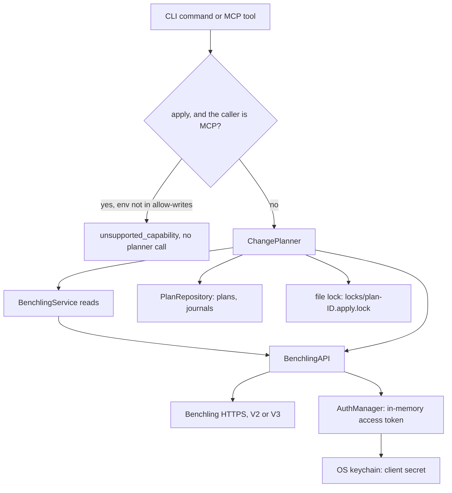
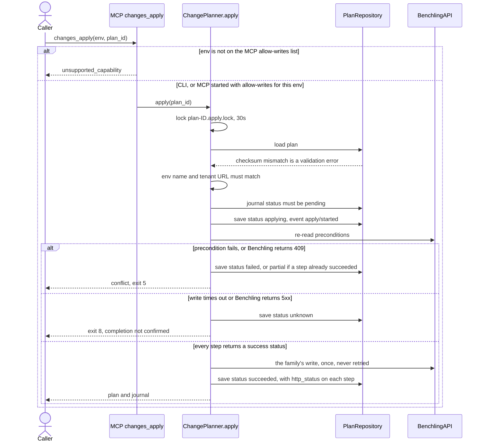
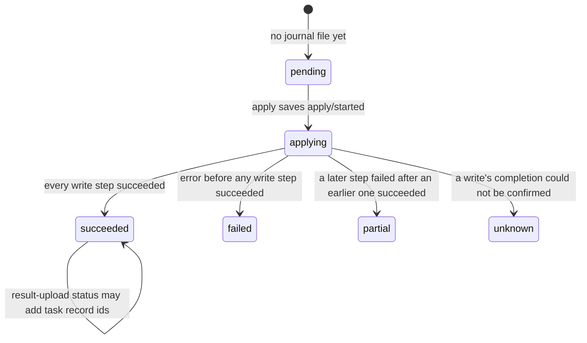
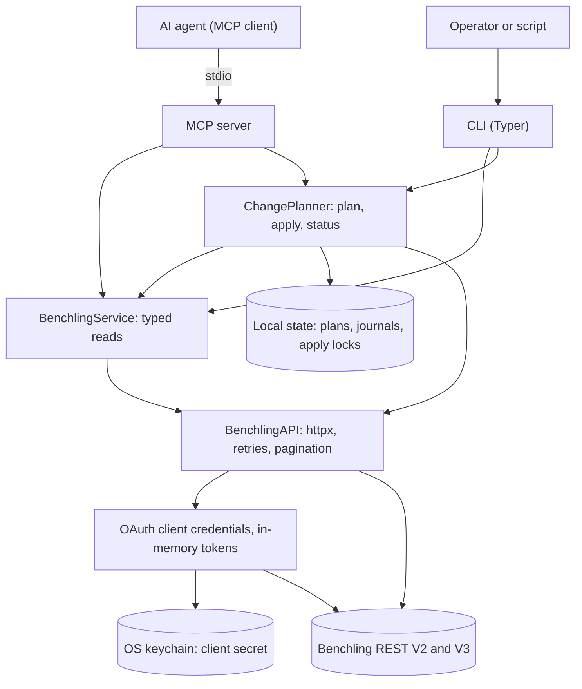

# Architecture

This document explains how a change moves from a preview, through an explicit apply, into a local journal. The module map at the end of this document is the directory view. The rest is the sequence.

The CLI and the MCP server call the same `ChangePlanner`. Preview reads Benchling and writes a plan file on this machine. Apply is a separate call. It re-checks the plan, takes a lock, and only then sends a write. The journal is the local record of that attempt.

Identifiers below are the synthetic ones used in tests and in the fixture demo (`etr_abc123`, `ver_1`). Tenant URLs in examples are the placeholder `https://your-tenant.benchling.com`.

## Where a call goes

Each CLI command is declared once in `cli.py` with `@command`. Typer builds the CLI from it, and `build_mcp_server` walks the same command tree and registers one tool per command, named after its path (`changes apply` is `changes_apply`). A tool runs the same function as the command; only the `Call` differs, which supplies the runtime and the apply check for that surface.

`changes_plan` does not pass through the write gate. It is allowed on a read-only MCP server because the remote calls it makes are reads. The plan file is local. `changes_apply` calls `Call.authorize_apply` before `ChangePlanner.apply`; on MCP that checks `writable_envs`. The CLI has no equivalent flag: `benchlingtk changes apply` is the operator's command.

MCP `changes_plan` validates the specification with `parse_change_specification` before any remote read. A shape that does not match the typed union returns `validation_error` and does not create a plan. The CLI accepts the same JSON, or a CSV result update, and the family planner validates it.

## Plan

`ChangePlanner.plan` builds one plan for one existing-entry mutation, one entry creation, or one container operation. It does not send POST, PATCH, or any other write.

1. The family must be `entry`, `document`, `table`, `fields`, `results`, or `containers`. A CSV-shaped request on another family is rejected.
2. Existing-entry families resolve an ID, display ID, or same-tenant URL to a canonical entry ID. Entry creation and container operations do not require an entry.
3. The family planner reads the relevant entry, template and folder, container schema, or source/destination containers, and returns `before`, `after`, `preconditions`, `guarantees`, and `warnings`.
4. The planner fills `env` and `tenant_url` from the active environment, stores the request, and sets `diff` to both sides plus a `changed` flag. That diff is not a structural patch.
5. `checksum_for` takes the SHA-256 of the plan's canonical JSON. The `checksum` field itself is excluded. Canonical JSON uses sorted keys and compact separators, so the hash survives a round trip through Pydantic.
6. `PlanRepository.save_plan` writes `plans/{id}.json`. The id is `uuid4().hex`. An id that is not 32 lowercase hex digits is rejected, which keeps the path inside the plans directory. An existing id is an error. The write is a temp file, mode `0600`, then a replace.

The saved plan is the preview the caller reviews. Changing the entry in Benchling after this point does not change the file. Apply decides whether the preview is still valid.

### What each family records

| Family | Read at plan time | Preconditions stored | Write, later, at apply |
|---|---|---|---|
| `entry` | Template, folder, and the template schema when schema fields are supplied | Template ID and folder ID; both were active at preview time | V3 `POST /entry` with `entryTemplateId`, `folderId`, `name`, and optional field-definition-ID `schemaFields` |
| `document` | Full entry | Entry version and the part ids | `PATCH /entry/{id}` `partsMutation` for insert, delete, or move. `replace_text` is an insert of the new text followed by a delete of the original, two requests |
| `table` | The unstructured table part, after checking it belongs to this entry | Entry version and entry id | `PATCH /entry/{id}` `update_table_cells` or `insert_table_rows`, with that version |
| `fields` | Entry schema and current field values | Schema id, a fingerprint of each touched field definition, and the observed values | `PATCH /entry/{id}` `schemaFields`, addressed by field-definition id |
| `results` upload | The `strtbl_…` table on this entry, its schema, and any named projects; any local files for attachment fields | Entry id, table id, schema id, schema-field fingerprint; each local file's size and SHA-256 | For each batch, any planned local files as V2 blobs, then `POST /assay-results:bulk-create` (V2) with their blob IDs. Local UUIDs in the plan are correlation ids, not server ids and not idempotency keys |
| `results` update | A local CSV, then each named result; any `file:` attachment cells | Per result: id, `modifiedAt`, entry id, schema id, definition fingerprint, observed values; each local file's size and SHA-256 | One `PATCH /result/{id}` per changed result, after every result has been re-checked and its planned files uploaded as V2 blobs |
| `containers` create | The selected container schema and embedded field definitions | Schema ID and the schema field-definition snapshot | One `POST /containers` |
| `containers` transfer | Source and destination containers | Both container IDs and their `modifiedAt` timestamps | One `POST /containers/{destination_id}:transfer` |

A document move that would leave the entry starting with anything other than a section fails here, with `Entry must start with a section`, and no plan is saved. Entry creation rejects archived or missing templates and folders; schema fields require a schema on the template and are normalized to field-definition IDs. A table plan rejects structured tables, merged child cells, and a coordinate that is outside the table or repeated. A field plan rejects unknown fields and values that do not match the definition. A result upload rejects a table that is not on the entry, a record whose schema does not match the table, more than 500 records, and a caller-supplied result id. A result update rejects a result that is not on the selected entry, a missing `modifiedAt`, an unknown column, and a CSV that changes nothing. A container create plan re-reads the schema before writing; a transfer plan re-reads both containers and refuses changed modification timestamps.

Warnings are part of the plan. They are how the preview says that a table edit clears evaluation until Benchling recalculates it, that `replace_text` can stop halfway, that uploaded results land as pending until a person accepts them in the results table (the plug icon), and that a result PATCH writes the result directly rather than through notebook integration.

## Apply

The order inside `_apply_locked` is fixed:

1. Load the plan. `load_plan` recomputes the checksum and refuses the file if it does not match.
2. `_check_plan_scope` requires `plan.env` and `plan.tenant_url` to equal the active environment. A plan created for `read` is not applied with `--env write`. A plan created for one tenant URL is not applied after that environment is pointed at another host.
3. Load the journal. A missing journal is treated as `pending`. Any other status raises `Plan has already been applied or attempted` and does not send a write.
4. Append `apply` / `started`, set the status to `applying`, and save. A crash after this save still leaves a non-pending journal, so the plan cannot be applied again.
5. Run the family apply, which re-reads the preconditions and then performs the write.
6. Save the terminal status.

The lock is `locks/plan-{id}.apply.lock`. The wait is 30 seconds. A timeout raises `Another process is applying this plan`. The lock is per plan, per machine. `changes status` takes the same lock when it writes task ids back into a result-upload journal, so that update does not race an apply.

`BenchlingAPI.request` retries only `GET`, and only on timeout or HTTP 408, 429, 500, 502, 503, and 504, up to three attempts. Every other method is one attempt. A non-GET that times out, or that receives a 5xx after the request was sent, raises `PartialCompletionError`: the write may have landed. That exception is recorded as journal status `unknown`. A definite error after a step has already succeeded is recorded as `partial`. A definite error before any write step has succeeded, including a stale-version conflict, is recorded as `failed`.

### Family checks at apply time

Document and table applies read the entry version again. If it differs from `preconditions.entry_version`, they refuse with `Entry version changed after the plan was created` and do not send the write. The mutation body then sends the version that was just read. If Benchling still returns HTTP 409, table apply rewrites that 409 to the same stale-version message. Document apply keeps the client's message, `The Benchling resource changed since it was read`. Either way the journal is `failed` when no write step had succeeded, and the plan is spent.

`replace_text` saves the journal after the insert and before the delete. If the process stops between them, the file already shows `insert_replacement` succeeded and the status is still `applying`. The delete is not retried by a second apply. The entry can contain both the new text and the original until a person reconciles it. The plan's warning states that.

Field apply compares the schema id, the field-definition fingerprint, and the observed values, then sends `PATCH /entry/{id}`. The entry-field API has no version field on that body, so the comparison is local. A change that lands after the comparison and before the PATCH can be overwritten. The plan's guarantee says `immediate pre-write field-value comparison`, and the warning says there is no atomic document-version precondition.

Result upload re-checks each table's entry relationship and schema fields, then sends one bulk-create POST per table batch. There is no idempotency key. A timeout or a missing task id is `unknown`, not a second POST; a definite failure does not stop remaining batches. Each submission is journaled with its table, task id, and local row-correlation IDs. `changes status` reads `GET /tasks/{id}` for every submitted batch and can poll with bounded backoff until terminal status or timeout. Only a valid task-error `index` maps to a batch's zero-based row; all raw errors are retained and unmatched shapes are called out rather than guessed. Task success means `pending_integration`. A person still accepts the pending results in each table in Benchling, and `apply` returns a `next_step` that names the tables.

Result update re-checks every result before the first PATCH. The check covers `modifiedAt`, the entry id, the schema id, the definition fingerprint, and the mapped values. `UpdateResultInput` has no version field, so `modifiedAt` is not sent to Benchling. A mismatch aborts with a conflict and no PATCH is sent. After the checks pass, each changed result is one `PATCH /result/{id}`. A failure on a later PATCH leaves the earlier ones applied. Those step events are in memory until the terminal save, so a crash in the middle leaves the on-disk journal at `applying` with only the `started` event. Replay is still refused. The CSV is not read again. Apply uses the updates frozen in the plan.

## Journal

`pending`, and only `pending`, may be applied. `applying`, `succeeded`, `failed`, `partial`, and `unknown` all refuse another apply. There is no retry command. A failed or stale plan is replaced by a new preview.

Each event is a timestamp, a stage, a status, and details. Write steps copy the response body and, when the HTTP status is known, `http_status`. A failure that never reached the API has no `http_status`. `save_journal` runs the event list and the result through `redact` before the file is written, and it replaces the in-memory copies with the scrubbed ones. Client secrets and access tokens registered in the process, and any field named `access_token`, `authorization`, `client_secret`, `id_token`, or `refresh_token`, are stored as `[redacted]`.

The journal file is `journals/{id}.json`, written atomically with mode `0600`. The event list grows during an apply, but each save replaces the whole file. The journal has no checksum. `status` for a result upload may add record ids to `result` under the apply lock. It does not change a `succeeded` journal back into something that can be applied.

| On-disk status | Meaning for the operator |
|---|---|
| `pending` | Preview only. Apply has not started. |
| `applying` | Apply started. If the process is gone, at least the start was saved. Do not assume the remote write is absent. |
| `succeeded` | Every write step returned a success status. Result uploads are still pending until a person accepts them in the table. |
| `failed` | The attempt stopped before any write step succeeded. A stale document or table version ends here. The plan is spent. |
| `partial` | A write step succeeded and a later step returned a definite error. Typical of `replace_text`, and of a result-update PATCH that fails after an earlier PATCH. |
| `unknown` | A write was sent and the client cannot say whether Benchling applied it: timeout, network loss, HTTP 5xx, or a result upload that returned no task id. |

## State on disk

`ConfigStore` roots everything at the platform config directory plus `benchlingtk`, or at `BENCHLINGTK_HOME`. `ensure` creates the root, `plans`, `journals`, and `locks` at mode `0700`. The blob planner adds `uploads` (mode `0700`) on first use: one `0600` file per planned local file, holding its absolute path, size and SHA-256 so the plan itself never contains the path. Apply deletes these files after its attempt, and a failed preview deletes its own. `environments.json` is the tenant URL and client ID for each environment, mode `0600`, written by `write_private`. The client secret is not in that file. It is in the OS keychain under the service name `benchlingtk`, with the environment name as the username. Access tokens stay in the `AuthManager` process. HTTPS uses the operating-system trust store from `tls.verified_context`. `http://` is rejected.

Two processes on one machine serialize on the per-plan lock. Two machines do not. A copied plan file is a new `pending` journal on the machine that did not apply it. Document and table versions make the second apply likely to conflict. Field updates, result uploads, and result PATCHes have no server-side idempotency key. The threat model describes that limit.

## What is intentionally shared

The CLI and MCP server construct a `Runtime` per environment: one `BenchlingAPI`, one `AuthManager`, one `BenchlingService`, one `ChangePlanner`, one `PlanRepository`. They return the same envelope (`schema_version` `1.0`) and the same exit-code classes. Tests run that stack against `tests/fake_benchling.py` through `httpx.MockTransport`. The [fixture demo](docs/demo.md) is that same path.

## Module map

| Module (`src/benchlingtk`) | Role |
|---|---|
| `cli.py` | Typer command-line interface; every command is declared once here |
| `commands.py` | Command declarations shared by the CLI and the MCP server |
| `mcp_server.py` | MCP tools generated from the CLI commands, read-only default, write allow-list |
| `change_spec.py` | Typed `changes_plan` specs and their validation |
| `services.py` | Typed read services and entry snapshots |
| `export.py` | Local JSON or CSV export; the response is a summary, not the rows |
| `stale.py` | Compares results-table cells with their linked result records and warns that the table needs **Re-sync table** in the UI |
| `listing.py` | Paged entry, schema, and dropdown discovery |
| `plans/planner.py` | `ChangePlanner`: plan, apply (under a per-plan file lock), status, journal |
| `plans/document.py`, `plans/table.py`, `plans/fields.py`, `plans/results.py` | One planning/apply mixin per change family |
| `plans/result_update.py` | CSV updates of existing results: re-check `modifiedAt`, then `PATCH /result/{id}` |
| `plans/blobs.py` | Local files for result attachment fields: hash at plan, re-check and upload as V2 blobs at apply |
| `plans/readback.py` | Read-back of pushed results: pending/accepted state and the field-by-field diff against a plan |
| `plans/repository.py` | Plan and journal persistence, checksums, JSON diff |
| `api.py` | HTTP client for Benchling REST V2/V3: retries for reads, never for writes |
| `auth.py` | OAuth client-credentials tokens, kept in memory |
| `credentials.py`, `keychain.py` | Login, logout, status, and OS keychain storage |
| `environment.py`, `config.py`, `runtime.py` | `environments.json`, state directories, per-environment runtimes |
| `redact.py` | Removes client secrets and access tokens from errors and journals |
| `models.py`, `errors.py` | Envelope, plan and journal models, error types and exit codes |
| `tls.py` | OS trust-store TLS |
