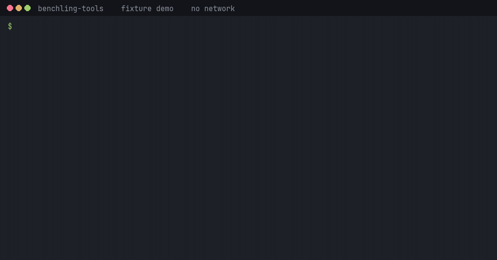

# benchling-tools

A CLI for coding agents and humans, directly mirrored as an MCP server for chat agents.

[](https://github.com/jmamodeo/benchling-tools/actions/workflows/ci.yml)
[](LICENSE)
[](pyproject.toml)

> **Unofficial; not affiliated with or endorsed by Benchling, Inc.** Benchling is a trademark of Benchling, Inc.

An electronic lab notebook is a scientific record, so letting an AI agent write to one directly is hard to trust. `benchling-tools` is a JSON-first command-line tool for a [Benchling](https://www.benchling.com) tenant that coding agents and people run directly. Each CLI command is also a tool on a local [Model Context Protocol](https://modelcontextprotocol.io) (MCP) server, so chat agents get the same commands, arguments, and replies. It uses the public Benchling API only and never automates the browser. It covers six change families: template-based entry creation, document text, unstructured tables, entry fields, assay results, and containers. Every change is first previewed as an immutable, checksummed plan, and a separate, explicit step applies it. You can keep several environments, each saved with `benchling-tools auth login` with its client secret in the OS keychain. Both interfaces return one versioned JSON envelope and stable exit codes.

**No public Python API.** benchling-tools has no public Python API. Its Python modules are internal and may change in any release. To script Benchling from Python, use the official [Benchling SDK](https://docs.benchling.com/docs/getting-started-with-the-sdk). A public Python API may be added if there is enough interest; [open a GitHub issue](https://github.com/jmamodeo/benchling-tools/issues) to say you want one.

## Demo



A scripted playback of the offline fixture demo (no credentials, no network). The [demo page](docs/demo.md) has the full transcript and the [asciinema cast](docs/demo.cast).

## Install

Python 3.11 or newer and [`uv`](https://docs.astral.sh/uv/) are required. The distribution and the command are both named `benchling-tools`, published on [PyPI](https://pypi.org/project/benchling-tools/). Install it with `uv tool install`, or run it without installing with `uvx benchling-tools`.

```console
uv tool install benchling-tools
benchling-tools --help
```

From a checkout, use `uv tool install .`, or `uv run benchling-tools` after `uv sync` (add `--extra dev` for the test and lint tools); `uv sync` does not put `benchling-tools` on PATH.

## Log in

Create the Benchling app and grant it project access first; see the [setup guide](docs/setup.md). Then run `benchling-tools auth login` in your own terminal. The client secret is read from a hidden prompt, or from stdin with `--secret-stdin`, and is never accepted as an argument. It goes to the OS keychain; there is no plaintext fallback.

```console
benchling-tools auth login --env dev
# Tenant URL: https://your-tenant.benchling.com
# Client ID: your-app-client-id
# Client secret (not echoed):
benchling-tools auth status
benchling-tools doctor --env dev
```

The toolkit acts as the **app**, with the app's permissions and audit identity, not the signed-in browser user. Login without a terminal, environment names, `auth status --check`, and `auth logout` are in the [reference](docs/reference.md#configuration).

## Headless Linux

Linux servers and agent machines often have no unlocked Secret Service on the session bus, and `benchling-tools` will not write the client secret to a plaintext file. Install `gnome-keyring` and `dbus`, unlock a keyring, and run the login in that session. A long-lived bus for MCP, later shells, and cron is needed too. The commands are in the [reference](docs/reference.md#headless-linux).

## CLI examples

There is no default environment: pass `--env NAME` (or `-e`) on every API command. Every command prints a versioned JSON envelope; diagnostics go to stderr.

```console
benchling-tools entry resolve EXP-0001 --env dev
benchling-tools entry inspect etr_abc123 --env dev
benchling-tools entry list --project src_example --modified-after 2026-01-01 --env dev
benchling-tools results tables etr_abc123 --env dev
benchling-tools export --kind table --part docpart_table1 --format csv --output measurements.csv --env dev

benchling-tools changes plan --entry etr_abc123 --family table --spec examples/table-set-cells.json --env dev
benchling-tools changes apply PLAN_ID --env dev
benchling-tools changes status PLAN_ID --env dev
```

Every command, the six change families, spec shapes, result uploads and attachments, pending results, and the canned examples are in the [CLI and MCP reference](docs/reference.md#cli-examples).

| Command | Purpose |
| --- | --- |
| `users list` | List visible users by handle, email, name, ID, or organization. |
| `users get` | Read a visible user by ID or exact handle. |
| `entry list` | List entries with server-side filters, including creator and author. |

For example, resolve a handle with `benchling-tools users get HANDLE --env dev`, then use the returned ID with `benchling-tools entry list --creator USER_ID --folder lib_example --env dev`. Handles may also be passed directly to `--creator` or `--author`.

## MCP server

One server serves every environment saved with `auth login`. The client config carries no secrets; the server reads the same `environments.json` file and OS keychain as the CLI.

```json
{
  "mcpServers": {
    "benchling-tools": {
      "command": "uvx",
      "args": ["benchling-tools", "mcp", "serve"]
    }
  }
}
```

Each CLI command is one tool named after its command path (`benchling-tools entry get` is `entry_get`), with the same arguments, defaults, and envelope. Commands that need a terminal or change local credentials have no tool. On Linux, add `DBUS_SESSION_BUS_ADDRESS` to the config's `env` block. The naming rule, the Linux config, and tool details are in the [reference](docs/reference.md#mcp-server).

## Safety model

- **Read-only by default.** `changes plan` only reads Benchling and writes an immutable local plan. Nothing changes remotely until `changes apply`, which re-checks the plan's version preconditions, refuses stale or already-used plans, never retries a write, and records each stage in a local journal.
- **Write guards on MCP.** The MCP server refuses `changes_apply` unless it was started with `--allow-writes ENV` for that environment. Reads, `export`, and `changes_plan` stay available.
- **Protected environments.** An environment marked with `auth protect` refuses a write unless its name is typed twice: `--env prod --confirm-env prod` on the CLI, or `confirm_env` equal to `env` on MCP.

The full safety model, design tradeoffs, exit codes, and known limitations are in the [reference](docs/reference.md#safety-model). The [threat model](docs/threat-model.md) covers what these controls do not protect against.

## Documentation

- [SKILL.md](SKILL.md): the agent guide, also installed with the package (`benchling-tools skill show`)
- [CLI and MCP reference](docs/reference.md): every command and tool, configuration, safety model, exit codes, and known limitations
- [Setup guide](docs/setup.md), [API limitations](docs/api-limitations.md), and [research record](docs/research.md)
- [Threat model](docs/threat-model.md): credentials, stale or replayed plans, write scoping, and agent misuse, including the limits of those controls
- [ARCHITECTURE.md](ARCHITECTURE.md): the plan, apply, and journal sequence and the module map
- [CHANGELOG.md](CHANGELOG.md)

## Citation

If you use this software, please cite it. GitHub's "Cite this repository" button uses [`CITATION.cff`](CITATION.cff) for [jmamodeo/benchling-tools](https://github.com/jmamodeo/benchling-tools).

## Contributing, security, license

- [Contributing guide](CONTRIBUTING.md), including tests and the opt-in sandbox exercise, and [Code of Conduct](CODE_OF_CONDUCT.md)
- [Security policy](SECURITY.md)
- Licensed under the [Apache License 2.0](LICENSE); see [NOTICE](NOTICE). Releases up to and including 0.4.1 were published under the MIT License and remain available under it.
