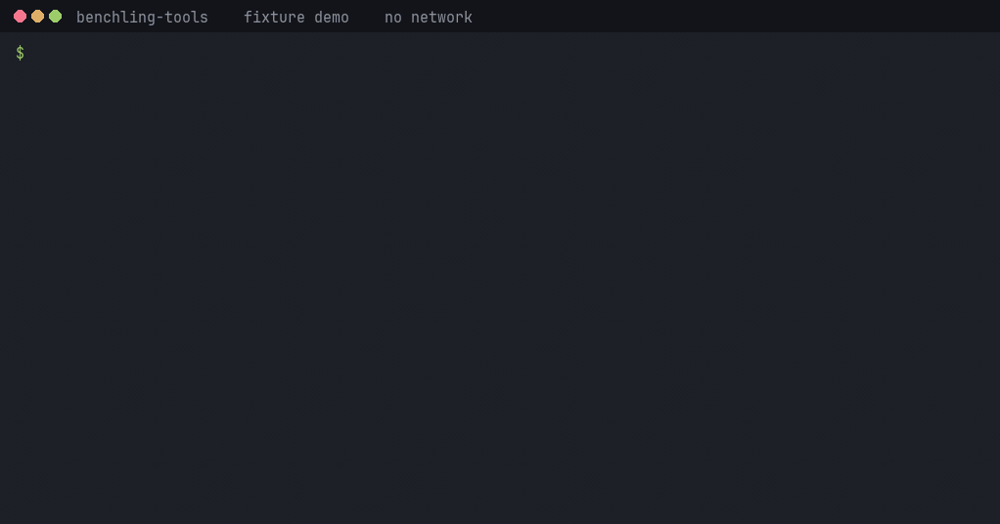

# Fixture demo



The picture and the [asciinema cast](demo.cast) are a scripted playback of one run of `uv run python scripts/demo.py`. `scripts/render_demo.py` builds both files from that script's stdout. The script runs the real CLI and MCP server against the offline fake API in `tests/fake_benchling.py`, through an in-process HTTP mock. No credentials are used and no network call is made. The cast is an asciinema v2 file assembled from that transcript. It is not a capture from the asciinema recorder, and it is not a live tenant. Plan IDs differ on every run. The transcript below is the same run as the picture.

<!-- demo-transcript:start -->
```console
# 1. Read an entry (envelope trimmed for readability)

$ benchling-tools entry inspect etr_abc123 --env demo
{
  "ok": true,
  "data": {
    "version_id": "ver_1",
    "project_id": "src_abc123"
  }
}
[exit 0]

# 2. Preview: reads Benchling, writes nothing remotely

$ benchling-tools changes plan --entry etr_abc123 --family table --spec set-cell-b2.json --env demo
{
  "ok": true,
  "data": {
    "id": "28e6765ddcbc4b28bc25386a6c6923c2",
    "family": "table",
    "env": "demo",
    "preconditions": {
      "entry_version": "ver_1",
      "entry_id": "etr_abc123"
    },
    "guarantees": [
      "server-enforced document version check"
    ],
    "warnings": [
      "Updating a cell or appending rows resets table evaluation until Benchling evaluates the table again"
    ]
  }
}
[exit 0]

remote writes so far: 0

# 3. Apply the first plan

$ benchling-tools changes apply 28e6765ddcbc4b28bc25386a6c6923c2 --env demo
{
  "ok": true,
  "data": {
    "journal": {
      "status": "succeeded",
      "events": [
        {
          "stage": "apply",
          "status": "started"
        },
        {
          "stage": "update_table_cells",
          "status": "succeeded"
        },
        {
          "stage": "apply",
          "status": "succeeded"
        }
      ]
    }
  }
}
[exit 0]

# 4. The second plan was previewed against the old entry version: apply is refused

$ benchling-tools changes apply da9c14532b7a4276a7948041d3505c1f --env demo
{
  "ok": false,
  "error": {
    "code": "conflict",
    "message": "Entry version changed after the plan was created",
    "retryable": false,
    "details": {
      "expected": "ver_1",
      "actual": "ver_2"
    }
  }
}
[exit 5]

# 5. A plan cannot be applied twice

$ benchling-tools changes apply 28e6765ddcbc4b28bc25386a6c6923c2 --env demo
{
  "ok": false,
  "error": {
    "code": "conflict",
    "message": "Plan has already been applied or attempted",
    "retryable": false,
    "details": {
      "plan_id": "28e6765ddcbc4b28bc25386a6c6923c2",
      "status": "succeeded"
    }
  }
}
[exit 5]

remote writes in total: 1

# 6. MCP server: read-only unless --allow-writes ENV is passed

changes_apply(env="demo", plan_id=...) ->
{
  "code": "unsupported_capability",
  "message": "MCP writes are disabled for demo; restart with `benchling-tools mcp serve --allow-writes demo`",
  "retryable": false,
  "details": {}
}
```
<!-- demo-transcript:end -->
