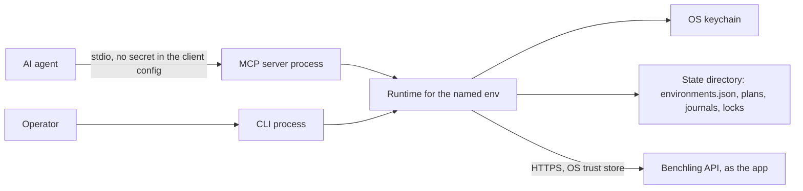

# Threat model

This document describes the controls in the current code for credentials, stale or replayed plans, write scope, and agent misuse. It also states the cases those controls do not close. It is a design record, not a penetration test and not a claim that Benchling's own permissions have been reviewed.

Examples use the placeholder tenant `https://your-tenant.benchling.com` and environment names such as `read` and `write`. They do not name a real tenant or organization.

## Boundaries

The process runs as an OS user. That user can read the keychain and the state directory. The toolkit does not try to stop the user who owns the files.

Benchling enforces the app's project permissions and audit identity. `--allow-writes` is a local switch on the MCP server. It cannot grant an access policy the app does not already have. Setup for the two-app split is in [setup.md](setup.md).

Entry text, table cells, and result values are data. The MCP server instructions tell the client to treat entry contents as untrusted. The toolkit does not scan that text for instructions.

An agent that can only call MCP tools is inside the tool boundary in the diagram above. An agent that can also run a shell as this user is outside it: the shell can invoke `benchling-tools changes apply` and can read the keychain. The MCP write gate is not a control against that agent.

## Assets

| Asset | Where it lives |
|---|---|
| Client secret | OS keychain, service `benchling-tools`, username = environment name. Also in process memory after login or after a command loads it |
| Access token | `AuthManager` memory only. Renewed before expiry. Not written to the keychain or to `environments.json` |
| Client ID and tenant URL | `environments.json`, mode `0600`. The client ID is an identifier, not the secret |
| Plan | `plans/{id}.json`, mode `0600`. Contains the request, the before/after preview, and the preconditions. That is a local copy of the entry data the plan touched |
| Journal | `journals/{id}.json`, mode `0600`. Contains step results and HTTP statuses, after redaction |
| Lab record | Benchling, reachable with the app's permissions |

## Credentials

`benchling-tools auth login` reads the client secret from a hidden prompt or from `--secret-stdin`. `_read_secret` never takes it from an argument, so it is not in the command line, shell history, or an MCP config `args` list. Login calls the token endpoint before it saves anything. A rejected secret leaves the keychain and `environments.json` unchanged. If the save fails after a successful token request, `login` rolls both the keychain entry and the file back.

`Keychain._usable` refuses the fail backend, the null backend, and any backend whose module or class name contains `plaintext`, and it refuses a backend whose priority is below 1. There is no plaintext file fallback. On Linux the keychain is Secret Service on the session bus. A missing bus, a missing provider, or a locked collection fails login with the cause and one fix command. That command quotes the environment name, tenant URL, and client ID. `$KEYRING_PASSWORD` and `$BENCHLING_CLIENT_SECRET` stay variable references.

`AuthManager` keeps one access token per `(environment name, base URL, client id)`. `TokenBundle.usable` treats a token as expired 60 seconds early. The client-credentials grant does not issue a refresh token, so renewal is a new token request. The secret stays in that `AuthManager.secrets` mapping for the life of the runtime. MCP startup calls `Keychain.get` until it finds one stored secret, and refuses to serve if none exist. `any` stops at the first hit, so startup does not load every environment. The first tool call for an env builds a `Runtime` that loads and keeps that env's secret. `register_secret` runs when a secret is read. A long-running server holds the secret of each env a tool call has used.

`register_secret` remembers the secret and each access token. `redact` replaces those strings when they appear in errors, envelopes, and journals, and it replaces values under the keys `access_token`, `authorization`, `client_secret`, `id_token`, and `refresh_token`. `Envelope` redacts before it is serialized. `save_journal` redacts before it writes. Strings shorter than 8 characters are not registered, because they collide with ordinary words. Benchling client secrets and access tokens are longer than that.

`prepare_tenant_url` rejects `http://` and rejects URLs that contain a username or password. `verified_context` builds a TLS client context from the OS trust store and does not disable chain or hostname checks.

`auth status` reports whether a keychain secret is present. It does not print the secret or the token. `auth logout` deletes the keychain item and the `environments.json` record. It does not revoke the app in Benchling. Rotating a leaked secret is a new secret in the Developer Console, then `auth login` again. Archiving the app is what revokes API access.

### What this does not do

- A same-user process can read the keychain. The toolkit cannot hide the secret from the account that stored it.
- `chmod` to `0600` or `0700` ignores `OSError`. A filesystem that rejects those modes can leave a file more readable than intended.
- Redaction is an exact substring match of registered values, plus a fixed set of keys. A secret that is split, encoded, or shorter than 8 characters is not scrubbed from free text. A value that happens to contain the secret as a substring is scrubbed too.
- The secret and the token remain in process memory. A dump of the MCP process contains them.
- Logout does not revoke the token Benchling already issued. This client drops its copy and uses the `expires_in` value Benchling returned, with a 60 second skew. It does not revoke the token at the token endpoint. The client secret works until it is rotated or the app is archived.
- The MCP SDK starts stdio servers with a short environment. `DBUS_SESSION_BUS_ADDRESS` has to be set in the client `env` block or the server cannot open the keychain. That is a failure to start, not a fallback onto a file.

## Stale or replayed plans

A plan is stale when the entry, fields, or results it was previewed against have changed. A plan is replayed when apply is asked to send the same write again. The controls are the checksum, the scope check, the journal status, the lock, the per-family precondition, and the refusal to retry a write.

| Control | Code | Effect |
|---|---|---|
| Checksum | `checksum_for`, `PlanRepository.load_plan` | SHA-256 of the canonical plan, excluding the checksum field. A file that does not match is not applied |
| Scope | `ChangePlanner._check_plan_scope` | `env` and `tenant_url` on the plan must equal the active environment |
| Single use | `_apply_locked` | Journal status must be `pending`. The status is saved as `applying` before the family's write |
| Lock | `ChangePlanner.apply` | One apply of a given plan id at a time on this machine, 30 second wait, then `Another process is applying this plan` |
| Preconditions | family `_apply_*` | Re-read before the write. Document and table also send the entry version and treat HTTP 409 as a conflict |
| No write retry | `BenchlingAPI.request` | `GET` may retry. POST and PATCH do not. Timeout or HTTP 5xx on a write is `unknown`, not a second request |
| Plan id | `SAFE_ID` | 32 hex digits. The plan and journal paths cannot escape their directories |

`applying`, `succeeded`, `failed`, `partial`, and `unknown` are all refusals. A stale document or table plan becomes `failed` and is spent. The operator previews again. That is deliberate: a second apply of a plan whose first attempt may have written is a replay.

`replace_text` saves the journal between its two PATCH calls. The other families keep step events in memory until the terminal save. A crash after a write and before that save leaves `applying` on disk and may leave the write applied in Benchling. Replay is refused. The journal may not yet list the HTTP status. Result updates re-check every row before the first PATCH, so a stale `modifiedAt` writes nothing. A crash or a failed later PATCH, after an earlier PATCH returned, can leave a prefix of the rows updated.

### What this does not do

- The checksum detects accidental corruption and a hand edit that forgets to recompute the hash. It is not a MAC and not a signature. A process that can write the state directory can change the plan and replace the checksum. The [reference safety section](reference.md#safety-model) states the same limit.
- The journal has no checksum. A process that can write `journals/{id}.json` can set the status back to `pending` and apply again. Single-use holds against the CLI and MCP tools, not against an editor on the file.
- The lock and the journal are local to one state directory. Copying a `pending` plan to another machine, or to another `BENCHLING_TOOLS_HOME`, starts a second pending journal. Document and table applies are likely to conflict on the entry version. Field updates, result uploads, entry creates, and result PATCHes can both succeed: they do not send an idempotency key. Result-upload correlation UUIDs are explicitly not idempotency keys.
- Field updates compare values and then PATCH. The body has no version. A write that arrives in that gap can be overwritten.
- Result updates compare `modifiedAt` and the mapped values, then PATCH. `UpdateResultInput` has no version field, so Benchling does not reject a stale PATCH. The gap is the time after the re-check and before that result's PATCH. Rows are patched sequentially, so a later row's gap is longer.
- Result upload and entry creation are POSTs. Two copies of a pending plan on different state directories can submit/create twice. A timeout is `unknown`, so the client will not retry on its own, but a person who then creates and applies a new plan can create a duplicate entry or submit records again.
- HTTP 409 is a conflict only when Benchling returns it. Table and document mutations send the version. Field PATCH and result PATCH do not.

## Write scoping

Every API command and every MCP tool except `auth_status` requires an environment name. There is no default. The plan stores the entry id resolved at preview time, and apply writes that id, not a new reference the caller supplies at apply time.

The write surface is the entry, document, table, fields, and results families. There is no tool that forwards an arbitrary method and path.

- Entry plans create one template-based entry in one folder. Preview checks both resources are active; apply does not re-read them, and Benchling checks current permissions and state.
- Document plans operate on parts of one entry. A move that would not leave a section at the start fails before a plan exists.
- Table plans call `get_table_for_entry`. The part must be on that entry and must be an unstructured table. Cell updates name row and column indexes. A merged child cell is rejected. The removed full-table replace operation is not a plan type.
- Field plans update fields that already exist on the entry's schema. Values are checked against the definition. The PATCH sends field-definition ids.
- Result uploads require a `strtbl_…` id that `get_result_table` finds on that entry, a matching result schema, readable project ids when they are present, and at most 500 records. Caller-supplied result ids are rejected.
- Result updates require each id to be on the selected entry (`Result is not on the selected entry` otherwise), a schema, and a `modifiedAt`. Only mapped columns that actually change are included. Unmapped columns are ignored and named in a warning. The CSV is read at plan time. Apply does not re-read it and does not follow a path stored in the request.
- A result-update request on a family other than `results` is rejected in `ChangePlanner.plan`.

`export` and `results rows` are reads of Benchling. Export's write is a local file. An existing file is left in place unless overwrite is set, using `os.link` so the no-overwrite path does not replace it.

`--allow-writes ENV` is repeatable and is checked in `changes_apply` before `planner.apply`. Startup rejects an allow-list name that is not a configured environment. `changes_plan` and `changes_status` do not consult the allow-list. `changes_status` still runs `_check_plan_scope`, so a plan from another environment or tenant is not returned.

The app's Benchling policy is the other half of the scope. A read-only app cannot be turned into a writer by `--allow-writes`. A write app can edit whatever that app's policy allows, which may be wider than one entry. The plan limits which of those objects this process will send, but Benchling remains the authority for what the app may do.

### What this does not do

- The CLI apply command does not check an allow-list. Anyone who can run `benchling-tools changes apply PLAN_ID --env write` as this user can apply a pending plan for `write`.
- Scope is one entry per plan, not one project and not a set of entries. Nothing in the planner stops a caller from creating many plans across many entries the app can see.
- Result PATCH and entry-field PATCH are not limited by an entry version on the wire. The entry check is the local comparison described above.
- Export's path is chosen by the caller. The tool will write any path the user may write, and overwrite will replace that path.

## Agent misuse

The MCP server is the agent boundary the code enforces.

`changes_apply` is registered with `destructiveHint` and without `readOnlyHint`. Those annotations are hints to the client. The check that refuses the call is `rt.environment.name not in writable_envs`. A server started without `--allow-writes` returns `MCP writes are disabled for {env}` and does not call `ChangePlanner.apply`. `changes_plan` stays available. A read-only agent can still read entries and can still create local plans, including a destructive preview. It cannot send the write through this server.

`--allow-writes` is consent for the process, not a confirmation on each call. Once the server is started with `--allow-writes write`, a tool call to `changes_apply` on `write` applies the plan. A protected environment also needs `confirm_env` equal to `env`. That argument is a prompt to the agent to ask the person, not proof that it did: an agent can pass the name without asking. There is no second human prompt inside the server. The preview still exists as a plan, and a careful client shows it before calling apply. A client that does not is acting within the consent the operator gave at startup.

Entry content is untrusted. A notebook that says to delete a section, or to call `changes_apply`, is data the agent will read. With writes disabled, apply fails. With writes enabled, the agent can plan and apply whatever the family validators accept. Run agents that read untrusted entries against a server that was not passed `--allow-writes`, and prefer a Benchling app whose policy is Read. Put the write app on a separate environment and pass `--allow-writes` only for a server you intend to let apply.

One server process can open every environment that has a keychain secret. The agent chooses the env argument. `auth_status` reports `writes_allowed` per env. An agent that can see both `read` and `write` will use `write` if it is on the allow-list. Do not point an untrusted client at a process that was started with `--allow-writes`.

`changes_plan` for a result update reads `csv_path` from the local filesystem. The path is not confined to a directory. That is a local read, performed as the user, of a path the agent supplied. The bytes affect the plan only when they parse as the mapped CSV. Apply does not open the path again.

A result attachment value `{"file": PATH}`, or a CSV cell `file:PATH`, is also a local path the agent supplies, and it is not confined to a directory either. Unlike the CSV, these bytes leave the machine: apply uploads the whole file to the tenant as a blob. Planning only hashes it and stores the path in an owner-only file under the state directory, so the plan and the preview carry the base name, size and hashes but not the path or the contents. Files inside the toolkit state directory (which holds `environments.json` and the plans) are refused, as are non-regular and empty files and files over 100 MiB. Apply re-hashes the file and refuses a plan whose file changed. The control that matters is the same as for any write: a person reads the preview's file list before apply, and the server needs `--allow-writes`.

A secret pasted into an agent transcript is already outside this process. The CLI will not accept that secret as an argument. It will accept it on stdin if something pipes it to `auth login --secret-stdin`. The intended path is a person at a terminal, or a CI secret that never enters the agent's prompt.

Issue drafts are a path from the tenant to a public repository. `issue_draft` and `benchling-tools issue draft` refuse a draft when any field looks like a tenant host (a `benchling.com` subdomain other than docs, help, or the placeholder tenants), a Benchling record or display ID, a known client secret, a token or key, or an email address. Findings name the field and the kind, never the value. The MCP tool only drafts; filing is the person opening the prefilled URL, or the CLI with `--file` after they confirm.

### What this does not do

- It does not prove an issue draft is free of tenant data. The checks are patterns, and free text such as a project or sample name passes them.
- It does not filter, quote, or sandbox entry text.
- It does not require a person to approve each MCP apply. Process start is the approval.
- It does not stop an agent with a shell. That agent is the OS user.
- It does not stop a read-only agent from copying data it is allowed to read, including into an export path.
- It does not stop a write-enabled agent from uploading any local file the OS user can read, outside the state directory, into a result attachment field.
- It does not stop a write-enabled agent from planning and applying many entries, as long as each plan passes the family checks and the app can write those entries.
- Tool annotations do not enforce anything. A client is free to ignore `destructiveHint`.

## Related code

| Concern | Location |
|---|---|
| Login, rollback, status | `credentials.py` `login`, `logout`, `collect_status` |
| Keychain and plaintext rejection | `keychain.py` `Keychain`, `_usable` |
| Tokens | `auth.py` `AuthManager` |
| Redaction | `redact.py` |
| TLS and tenant URL | `tls.py`, `models.py` `prepare_tenant_url` |
| Plan, lock, journal transitions | `plans/planner.py` `ChangePlanner` |
| Checksum and atomic files | `plans/repository.py` |
| Document, table, field writes | `plans/document.py`, `plans/table.py`, `plans/fields.py` |
| Result upload and CSV update | `plans/results.py`, `plans/result_update.py` |
| Read retry, write no-retry | `api.py` `BenchlingAPI.request` |
| MCP allow-list and typed specs | `mcp_server.py` `McpCall.authorize_apply`, `change_spec.py` |
| State directory modes | `config.py`, `environment.py` `write_private` |
